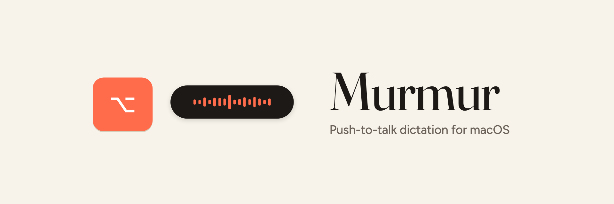
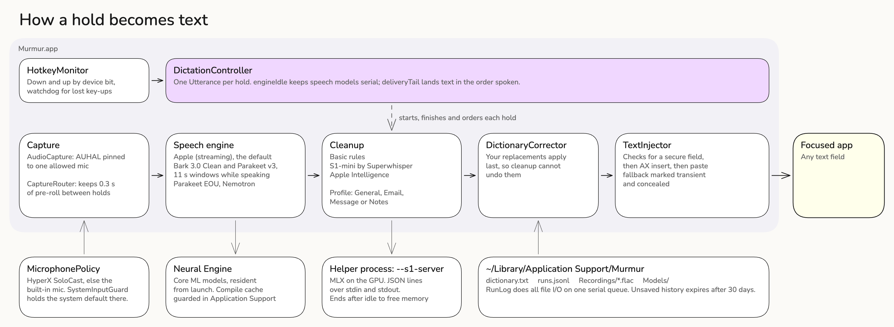
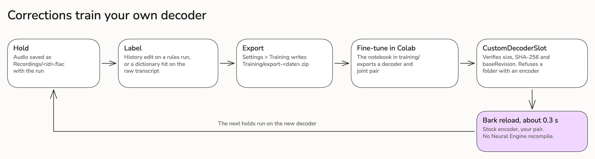

Hold a key, talk, let go. Murmur types the cleaned-up text into the focused field. Speech
recognition and cleanup run on your Mac, and no audio or text leaves it.

https://github.com/user-attachments/assets/5baf9270-7fb8-4c33-ac53-569dd8c126af

A recording of the installed app in TextEdit. Right ⌘ is held for one sentence, and Bark 3.0
Clean on the Neural Engine types the text 0.45 s after release.

## Install

Apple silicon, macOS 26 or later, Xcode with Swift 6.2. There is no prebuilt download yet.

```bash
make install
```

That builds a signed release bundle, copies it to `/Applications` and launches it. Grant three
permissions, then restart Murmur after the Accessibility one.

| Permission | Used for |
|---|---|
| Accessibility | The hotkey and inserting text |
| Microphone | Capture |
| Input Monitoring | Spotting a key-up that another event tap swallowed |

Hold **Right ⌥** and talk. Settings > Push to talk can switch it to fn or Right ⌘. Give each
dictation app on the Mac its own key, or two of them record and both type.

## iPhone keyboard

Murmur also runs on the iPhone as a dictation keyboard. Tap the Murmur key, talk, and tap
again to type the text into the current field. The keyboard records audio itself, so you never
switch apps. Bark 3.0 Clean and the cleanup rules run on the phone, and no audio or text leaves
it. The keyboard has punctuation, numbers, emoji and your recent dictations, but no letters.

https://github.com/user-attachments/assets/ba791e58-7b6f-434b-bb07-7feb3376c681

There is no App Store or TestFlight build yet. To build it yourself you need:

- an iPhone on iOS 26 or later, a Mac with Xcode 26, and [XcodeGen](https://github.com/yonaskolb/XcodeGen) (`brew install xcodegen`)
- a paid Apple Developer membership. The app and the keyboard share files through an App
  Group, and free personal teams cannot use App Groups.

1. Put your signing team in `ios/Local.xcconfig` (git ignores it):

   ```
   DEVELOPMENT_TEAM = ABCDE12345
   ```

2. Replace `ai.pivotstudio.murmur` with your own identifier. It belongs to another team, so
   Xcode will not sign it for you:

   ```bash
   sed -i '' 's/ai\.pivotstudio\.murmur/com.yourname.murmur/g' ios/project.yml ios/Shared/PhoneEnvironment.swift
   ```

3. Connect the iPhone, unlock it, turn on Developer Mode (Settings > Privacy & Security), then:

   ```bash
   make ios-install
   ```

   This builds a signed Release and installs it on the first connected iPhone. To use Xcode
   instead, run `make ios-project`, open `ios/Murmur.xcodeproj` and run the `MurmurPhone`
   scheme.

4. Open Murmur on the phone and follow the Setup tab. Allow the microphone and speech
   recognition, and download Bark (450 MB). Then add the keyboard in Settings > General >
   Keyboard > Keyboards > Add New Keyboard > Murmur and turn on **Allow Full Access**. The
   keyboard records through WebKit under the app's microphone permission, and that needs
   Full Access.

5. In any text field, hold the globe key and pick Murmur. Tap the key to start and tap again
   to type, or hold it for push-to-talk. After each install, the first Bark load compiles for
   the Neural Engine and takes about 90 s. Apple's transcriber handles dictation until then.

**With the Mac app.** The two apps run independently, and both have Bark 3.0 Clean and the
cleanup rules. To train on phone dictations, correct them in the phone's History tab and
export them from Settings > Training > Export labelled recordings. Send the zip to your Mac,
for example over AirDrop, and open it with Settings > Training > Import from iPhone. The runs
join the Mac's history and its next training export.

## Engines

Pick a speech engine in Settings > Model or from the menu bar. Apple needs no setup; the rest run
on the Neural Engine through [FluidAudio](https://github.com/FluidInference/FluidAudio) and
download once.

| Engine | Notes |
|---|---|
| Apple (streaming) | Default, no download |
| Parakeet | 470 MB |
| Bark 3.0 Clean | 450 MB, drops fillers and false starts. One Neural Engine compile on first load |
| Parakeet EOU, Nemotron | Streaming, English |

Cleanup runs after transcription: basic rules (instant), S1-mini by Superwhisper (MLX in a
helper process, 1.5 GB download converted to a 331 MB 4-bit build on your Mac) or Apple
Intelligence. S1-mini takes a profile: General, Email, Message or Notes. Your dictionary
applies last, so cleanup cannot undo a replacement. It is the file
`~/Library/Application Support/Murmur/dictionary.txt`.

Recording never starts a download. Bark and Parakeet load at launch when they are on disk.
If you press the key before they finish, Apple's transcriber handles that hold.

## How it works



Each hold is its own `Utterance`, so you can press again while the last one is still
finishing. Three design decisions matter most:

- **The HUD never takes focus.** It is a non-activating panel. If it became key, your text
  field would lose focus and there would be nowhere to type.
- **Capture never uses the system default input.** `AudioCapture` runs its own input-only
  audio unit pinned to one allowed mic. `AVAudioEngine` follows the default, and a Bluetooth
  headset that became the default once crashed the app on every launch.
- **Models stay resident when a reload costs more than the memory.** Bark and Parakeet cost
  about 30 MB and a Core ML recompile can take two minutes, so they stay. S1-mini lives in a
  helper process, so ending it returns all of its memory.


Release time does not grow with the length of a hold. While the key is down, Murmur decodes
speech in 11 s windows and cleans each finished sentence. At release it processes only the
rest.



Your corrections can train a decoder on your own vocabulary. Murmur exports nothing until you
press the button in Settings > Training, and the zip stays on your Mac until you upload it to
Colab. See [training/README.md](training/README.md).

## Privacy

Murmur's own code makes one kind of network request: model downloads from Hugging Face.

- By default the mic stays open between holds and keeps the last 0.3 s in memory, so a hold
  includes the audio from just before the key press. Murmur stores nothing outside a hold.
  Settings > Microphone turns this off.
- Every hold saves its audio as FLAC in `~/Library/Application Support/Murmur/Recordings/`
  beside its history entry. Murmur deletes runs older than 30 days unless you saved or
  labelled them.
- Murmur types nothing into a password field. The paste fallback marks its clipboard entry
  transient and concealed, so clipboard managers skip it.

## Development

```bash
make test                 # dictionary vectors and macOS 26 app regression tests
make build CONFIG=debug   # SwiftPM compile only
make app                  # signed bundle in ~/Library/Caches/MurmurBuild
```

Always build with `make`, which keeps build output out of the repo.
`Tests/MurmurDictionaryTests/dictionary-test-vectors.json` defines correction behaviour, so
change the vectors first. [AGENTS.md](AGENTS.md) records the traps in this codebase.

The installed binary has checks that need no microphone unless an audio file is named:

```bash
M=/Applications/Murmur.app/Contents/MacOS/Murmur
$M --cleanup-check                     # S1-mini end to end
$M --incremental-check <audio-file>    # streaming against batch
$M --residency-check <file>            # model memory and load times
$M --decoder-check <slot> <audio>      # a fine-tuned decoder against stock
```

If an Accessibility grant gets stuck, reset that one entry (without the bundle ID,
`tccutil` resets every app):

```bash
tccutil reset Accessibility ai.pivotstudio.murmur
```

```
Sources/Murmur/
├── Core/            hotkey, capture, routing, injection, DictationController
├── Transcription/   Mac-only engines (streaming, Wispr reader)
├── Formatting/      S1-mini and its helper
├── Support/         Mac storage and settings extensions, permissions, check commands
└── UI/              components, main window, settings, HUD
Sources/MurmurKit/          text pipeline, engines, settings and run log shared with the iPhone
Sources/MurmurDictionary/   corrector, no app dependencies
Sources/MurmurDesign/       design system shared with the iPhone
ios/                        iPhone app and dictation keyboard (make ios-project, make ios-build)
training/                   Colab fine-tuning notebook
promo/                      Remotion source for the promo video and banner
docs/diagrams/              Excalidraw sources for the diagrams above
```

## Not built yet

- Command Mode: hold a second key over selected text and say "make this more formal"
- A first-run window for the permissions on the Mac (the iPhone app has a Setup tab)
- Picking the cleanup profile from the focused app
- Notarization and a downloadable release

## License

Copyright (C) 2026 Tanmay Nargas. Murmur is free software under the
[GNU General Public License v3.0 only](LICENSE). It comes with no warranty.

Murmur began as a fork of [murmur-youtube](https://github.com/per-simmons/murmur-youtube) by Pat
Simmons. That repository has no license, so the code inherited from it was replaced before this
license was applied; older commits in this history are not covered by the GPL grant.

Third-party terms are in [THIRD_PARTY.md](THIRD_PARTY.md). Model weights are downloaded and are
not part of this repository. S1-mini is by Superwhisper, and its license requires that name.
