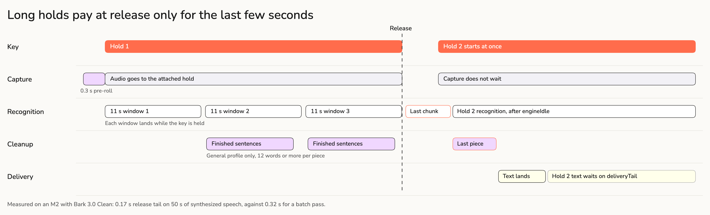

Hold a key, talk, let go. Murmur types the cleaned-up text into the focused field. Speech
recognition and cleanup run on your Mac, and no audio or text leaves it.

https://github.com/user-attachments/assets/5baf9270-7fb8-4c33-ac53-569dd8c126af

A recording of the installed app in TextEdit. Right ⌘ is held for one sentence, and Bark 3.0
Clean on the Neural Engine types the text 0.45 s after release.

## On the iPhone

Murmur is also a dictation keyboard. Tap the Murmur key, talk, and tap again to type the text
into whatever field you are in, without switching apps. Bark 3.0 Clean runs on
the phone.

https://github.com/user-attachments/assets/ba791e58-7b6f-434b-bb07-7feb3376c681

## Get it

There is no prebuilt download yet; both apps build from source.

- **Mac** (Apple silicon, macOS 26): `make install`, then grant Accessibility, Microphone and
  Input Monitoring. Hold Right ⌥ to talk. Details, engines and settings:
  [docs/mac.md](docs/mac.md).
- **iPhone** (iOS 26, Xcode 26, a paid Apple Developer account): set your team and bundle ID,
  then `make ios-install`. Steps and setup: [ios/README.md](ios/README.md).

## How it works

Each hold is its own `Utterance`, so you can press again while the last one is still
finishing. Three design decisions matter most:

- **The HUD never takes focus.** It is a non-activating panel. If it became key, your text
  field would lose focus and there would be nowhere to type.
- **Capture never uses the system default input.** `AudioCapture` runs its own input-only
  audio unit pinned to one allowed mic. `AVAudioEngine` follows the default, and a Bluetooth
  headset that became the default once crashed the app on every launch.
- **Models stay resident when a reload costs more than the memory.** Bark and Parakeet cost
  about 30 MB and a Core ML recompile can take two minutes, so they stay. S1-mini lives in a
  helper process, so ending it returns all of its memory.

Release time does not grow with the length of a hold. While the key is down, Murmur decodes
speech in 11 s windows and cleans each finished sentence. At release it processes only the
rest.

Your corrections can train a decoder on your own vocabulary. Murmur exports nothing until you
press the button in Settings > Training, and the zip stays on your Mac until you upload it to
Colab. See [training/README.md](training/README.md).

## Privacy

Murmur's own code makes one kind of network request: model downloads from Hugging Face.
Recordings stay on the device, Murmur deletes history older than 30 days unless you save it,
and it types nothing into password fields. The details are in [docs/mac.md](docs/mac.md#privacy).

## Docs

| Read | For |
|---|---|
| [docs/mac.md](docs/mac.md) | Mac install, permissions, engines, cleanup, privacy |
| [ios/README.md](ios/README.md) | Building and setting up the iPhone keyboard, and using it with the Mac |
| [Sources/README.md](Sources/README.md) | Build and test commands, checks, source layout |
| [AGENTS.md](AGENTS.md) | Design decisions and the traps in this codebase |
| [training/README.md](training/README.md) | Fine-tuning Bark's decoder on your corrections |
| [bench/README.md](bench/README.md) | Benchmarking a speech model against your recordings |

## Not built yet

- Command Mode: hold a second key over selected text and say "make this more formal"
- A first-run window for the permissions on the Mac (the iPhone app has a Setup tab)
- Picking the cleanup profile from the focused app
- Notarization and a downloadable release

## License

Copyright (C) 2026 Tanmay Nargas. Murmur is free software under the
[GNU General Public License v3.0 only](LICENSE). It comes with no warranty.

Murmur began as a fork of [murmur-youtube](https://github.com/per-simmons/murmur-youtube) by Pat
Simmons. That repository has no license, so the code inherited from it was replaced before this
license was applied; older commits in this history are not covered by the GPL grant.

Third-party terms are in [THIRD_PARTY.md](THIRD_PARTY.md). Model weights are downloaded and are
not part of this repository. S1-mini is by Superwhisper, and its license requires that name.
