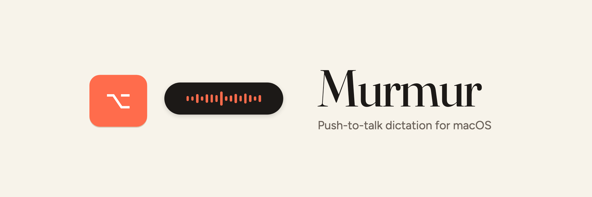
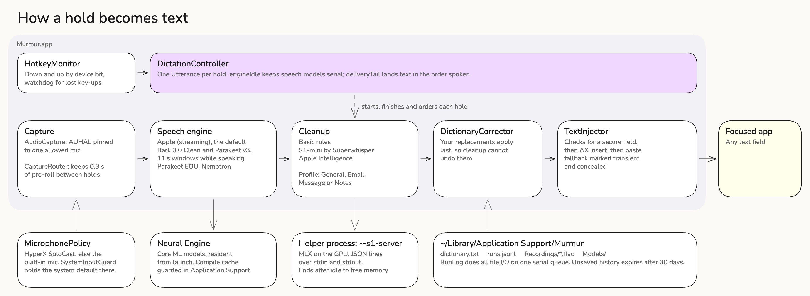
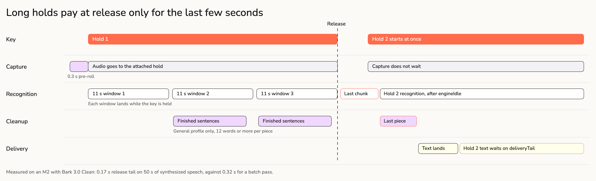
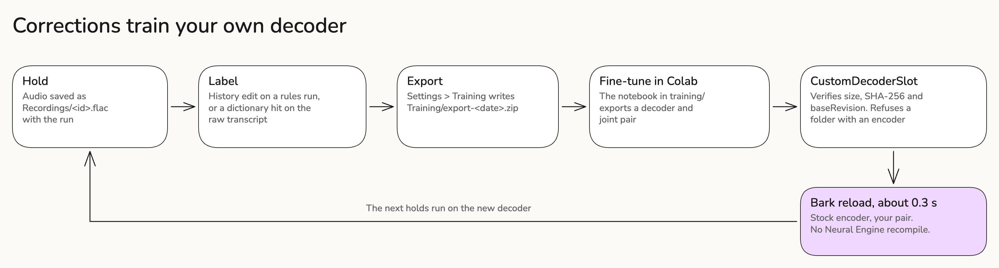

Hold a key, talk, let go. The cleaned-up text lands in whatever field has focus. Speech
recognition and cleanup both run on your Mac, and nothing leaves it.

https://github.com/user-attachments/assets/7c77174c-abcb-4deb-aa8a-605a4560b697

A real recording of the installed app with sound: Right ⌘ held in TextEdit, a sentence
spoken, and Bark 3.0 Clean on the Neural Engine landing the text 0.45 s after release. The
31 s promo is [murmur-promo.mp4](docs/media/murmur-promo.mp4).

## Install

Apple silicon, macOS 26 or later, Xcode with Swift 6.2. There is no prebuilt download yet.

```bash
make install
```

That builds a signed release bundle, copies it to `/Applications` and launches it. Grant three
permissions, then restart Murmur after the Accessibility one.

| Permission | Used for |
|---|---|
| Accessibility | The hotkey and inserting text |
| Microphone | Capture |
| Input Monitoring | Spotting a key-up that another event tap swallowed |

Hold **Right ⌥** and talk. Settings > Push to talk can switch it to fn or Right ⌘. Give each
dictation app on the Mac its own key, or two of them record and both type.

## Engines

Pick a speech engine in Settings > Model or from the menu bar. Apple needs no setup; the rest run
on the Neural Engine through [FluidAudio](https://github.com/FluidInference/FluidAudio) and
download once.

| Engine | Notes |
|---|---|
| Apple (streaming) | Default, no download |
| Parakeet | 470 MB |
| Bark 3.0 Clean | 450 MB, drops fillers and false starts. One Neural Engine compile on first load |
| Parakeet EOU, Nemotron | Streaming, English |

Cleanup runs after transcription: basic rules (instant), S1-mini by Superwhisper (MLX in a
helper process, 1.5 GB download converted to a 331 MB 4-bit build on your Mac) or Apple
Intelligence. S1-mini takes a profile: General, Email, Message or Notes. Your dictionary
applies last, so cleanup cannot undo a replacement; it lives at
`~/Library/Application Support/Murmur/dictionary.txt`.

Recording never starts a download. Bark and Parakeet load at launch when they are on disk,
and Apple's transcriber stands in if you press the key before they finish.

## How it works



Each hold is its own `Utterance`, so you can press again while the last one is still
finishing. Three decisions carry the rest:

- **The HUD never takes focus.** It is a non-activating panel. If it became key, your text
  field would lose focus and there would be nowhere to type.
- **Capture never uses the system default input.** `AudioCapture` runs its own input-only
  audio unit pinned to one allowed mic. `AVAudioEngine` follows the default, and a Bluetooth
  headset that became the default once crashed the app on every launch.
- **Models stay resident when a reload costs more than the memory.** Bark and Parakeet cost
  about 30 MB and a Core ML recompile can take two minutes, so they stay. S1-mini lives in a
  helper process, so ending it returns all of its memory.



Long holds do not pay for their length at release. Speech is decoded in 11 s windows while
the key is down, finished sentences are cleaned as they appear, and release only handles
what is left.



Your corrections can train a decoder for your own vocabulary. Nothing is exported until you
press the button in Settings > Training, and the zip stays on your Mac until you upload it to
Colab yourself. See [training/README.md](training/README.md).

## Privacy

Murmur's own code makes one kind of network request: model downloads from Hugging Face.

- The mic stays open between holds by default and keeps the last 0.3 s in memory, so a hold
  includes the moment before the key landed. Nothing outside a hold is stored. Settings >
  Microphone turns this off.
- Every hold saves its audio as FLAC in `~/Library/Application Support/Murmur/Recordings/`
  beside its history entry. Runs older than 30 days are deleted unless you saved or labelled
  them.
- Nothing is typed when focus is in a password field. The paste fallback marks the clipboard
  entry transient and concealed for clipboard managers.

## Development

```bash
make test                 # dictionary vectors and macOS 26 app regression tests
make build CONFIG=debug   # SwiftPM compile only
make app                  # signed bundle in ~/Library/Caches/MurmurBuild
```

Always build with `make`, which keeps output out of the repo.
`Tests/MurmurDictionaryTests/dictionary-test-vectors.json` defines correction behaviour;
change the vectors first. [AGENTS.md](AGENTS.md) records the traps in this codebase.

The installed binary has checks that need no microphone unless an audio file is named:

```bash
M=/Applications/Murmur.app/Contents/MacOS/Murmur
$M --cleanup-check                     # S1-mini end to end
$M --incremental-check <audio-file>    # streaming against batch
$M --residency-check <file>            # model memory and load times
$M --decoder-check <slot> <audio>      # a fine-tuned decoder against stock
```

If an Accessibility grant gets stuck, reset that one entry (without the bundle ID,
`tccutil` resets every app):

```bash
tccutil reset Accessibility ai.pivotstudio.murmur
```

```
Sources/Murmur/
├── Core/            hotkey, capture, routing, injection, DictationController
├── Transcription/   engines and model stores
├── Formatting/      rules, S1-mini, Apple Intelligence, cleanup pipeline
├── Dictionary/      dictionary file and store
├── Support/         settings, run log, recordings, training, check commands
└── UI/              design system, main window, settings, HUD
Sources/MurmurDictionary/   corrector, no app dependencies
training/                   Colab fine-tuning notebook
promo/                      Remotion source for the promo video and banner
docs/diagrams/              Excalidraw sources for the diagrams above
```

## Not built yet

- Command Mode: hold a second key over selected text and say "make this more formal"
- A first-run window for the permissions
- Picking the cleanup profile from the focused app
- Notarization and a downloadable release

## License

Copyright (C) 2026 Tanmay Nargas. Murmur is free software under the
[GNU General Public License v3.0 only](LICENSE). It comes with no warranty.

Murmur began as a fork of [murmur-youtube](https://github.com/per-simmons/murmur-youtube) by Pat
Simmons. That repository has no license, so the code inherited from it was replaced before this
license was applied; older commits in this history are not covered by the GPL grant.

Third-party terms are in [THIRD_PARTY.md](THIRD_PARTY.md). Model weights are downloaded and are
not part of this repository. S1-mini is by Superwhisper, and its license requires that name.
